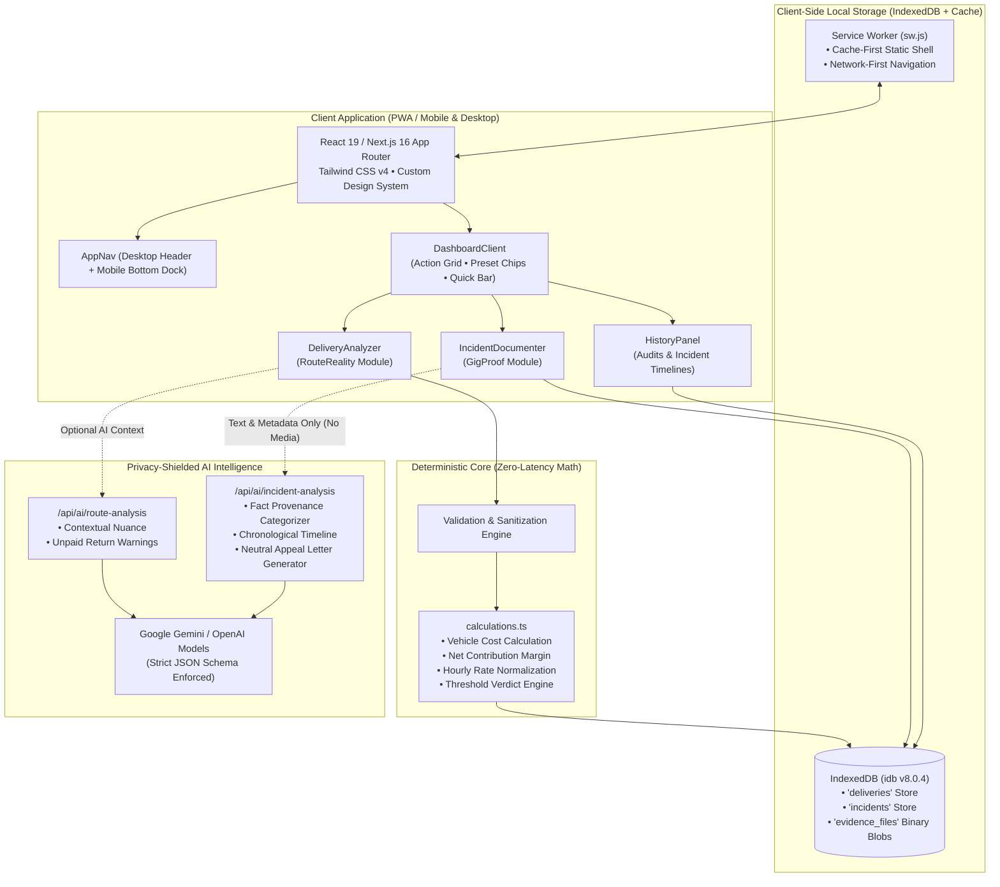
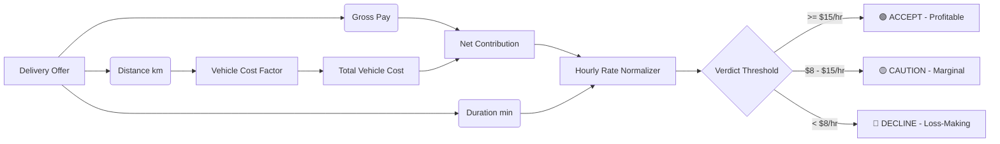
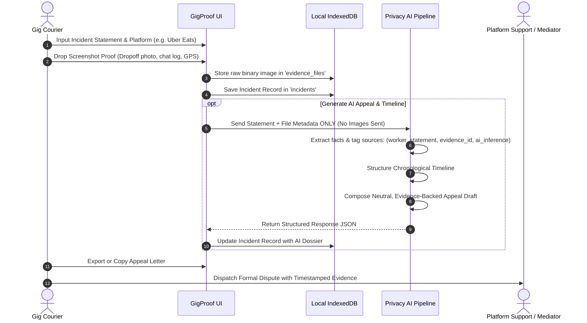
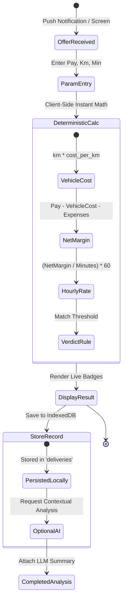
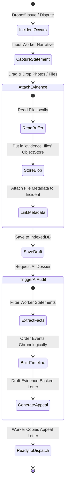

<div align="center">

# 🛵 GigSense

### **Financial Intelligence & Evidence Ledger for Gig Couriers**

*Bridging the algorithmic information asymmetry between on-demand gig platforms and delivery couriers.*

[](https://nextjs.org/)
[](https://react.dev/)
[](https://www.typescriptlang.org/)
[](https://tailwindcss.com/)
[](https://web.dev/progressive-web-apps/)
[](https://developer.mozilla.org/en-US/docs/Web/API/IndexedDB_API)
[]()

</div>

---

## 📖 Table of Contents

- [Overview & The Problem](#-overview--the-problem)
- [System Architecture](#-system-architecture)
- [Core Modules](#-core-modules)
  - [1. RouteReality: Offer Profitability Engine](#1-routereality-offer-profitability-engine)
  - [2. GigProof: Incident & Dispute Documenter](#2-gigproof-incident--dispute-documenter)
  - [3. Offline-First PWA Engine](#3-offline-first-pwa-engine)
- [Mathematical & Decision Model](#-mathematical--decision-model)
- [Comparative Profitability Benchmark](#-comparative-profitability-benchmark)
- [Data Flow & Lifecycle Diagrams](#-data-flow--lifecycle-diagrams)
- [Tech Stack & Architecture Details](#-tech-stack--architecture-details)
- [Repository Structure](#-repository-structure)
- [Getting Started & Local Setup](#-getting-started--local-setup)
- [PWA Installation Guide](#-pwa-installation-guide)
- [Privacy, Ethics & AI Guardrails](#-privacy-ethics--ai-guardrails)
- [Roadmap](#-roadmap)

---

## 💡 Overview & The Problem

Delivery workers on platforms such as **Uber Eats, DoorDash, Menulog, Grubhub, and Deliveroo** face deep algorithmic information asymmetry every single day:

1. **Split-Second Blind Decisions**: Couriers are given between 10 and 45 seconds to accept or reject incoming offers while actively navigating traffic.
2. **Hidden True Costs**: Platform offers showcase gross headline pay (e.g., "$8.50 for 9km"), obscuring vehicle depreciation, fuel burn, maintenance costs, and unpaid return trip deadheads. Many accepted orders actually net below minimum wage—or incur net financial losses.
3. **Vulnerable Account Standing**: One false customer dispute ("Order never arrived", "Delivered cold", or fraudulent rating) can trigger automated de-platforming, account suspension, or loss of livelihood without worker recourse.

**GigSense** is a privacy-first, local-first **Progressive Web App (PWA)** engineered to empower gig workers with:
- **Instant Mathematical Clarity**: Deterministic vehicle cost modeling and real net contribution per hour calculations.
- **Tamper-Evident Evidence Logging**: Structured incident logging with secure offline screenshot and document preservation.
- **AI-Powered Dispute Defense**: Objective fact extraction and professional, evidence-backed appeal letter drafting.

```
┌─────────────────────────────────────────────────────────────────────────────┐
│                                G I G S E N S E                              │
├──────────────────────────────────────┬──────────────────────────────────────┤
│             RouteReality             │               GigProof               │
│     [ Profitability Intelligence ]   │       [ Evidence & Appeal Ledger ]   │
├──────────────────────────────────────┼──────────────────────────────────────┤
│  • True Vehicle Operating Cost/km    │  • Tamper-Evident Incident Capture   │
│  • Real Net Contribution Margin ($)  │  • Multi-File Media Dropzone (IDB)   │
│  • Effective Hourly Earning Rate     │  • Provenance-Labeled Fact Extractor │
│  • Deterministic Accept/Reject Rules │  • Structured Dispute Appeal Writer  │
├──────────────────────────────────────┴──────────────────────────────────────┤
│          Zero-Cloud Local Storage (IndexedDB) • PWA Offline-First           │
└─────────────────────────────────────────────────────────────────────────────┘
```

---

## 🏛 System Architecture

The following diagram illustrates the complete architectural pipeline of GigSense, highlighting its client-side isolation, local storage persistence, and privacy-shielded AI services:



---

## ⚡ Core Modules

### 1. RouteReality: Offer Profitability Engine

RouteReality evaluates the economic viability of delivery offers before the gig worker commits their vehicle and labor.



- **Custom Vehicle Cost Modeling**: Workers set their exact cost per kilometer (fuel/battery depletion, tire wear, oil changes, insurance, and vehicle depreciation).
- **Net Contribution Calculation**: Computes actual gross profit remaining after deducting estimated operating costs and out-of-pocket expenses (parking, tolls).
- **Effective Hourly Wage Rate**: Converts trip contribution into an hourly equivalent for direct comparison against living wage benchmarks.
- **Offer Presets for Instant Benchmarking**:
  - `DoorDash`: $18.00 / 6.0 km / 22 min ➔ **High Yield**
  - `Uber Eats`: $8.50 / 8.5 km / 35 min ➔ **Marginal / Caution**
  - `Menulog`: $28.00 / 11.0 km / 40 min ➔ **High Yield**
  - `Low-ball Stacker`: $4.50 / 5.0 km / 20 min ➔ **Decline**

---

### 2. GigProof: Incident & Dispute Documenter

GigProof creates a defensible, chronological timeline of delivery disputes, cancellations, and false claims.



#### Fact Provenance Tagging
GigProof's AI categorizer strictly distinguishes between:
- `worker_statement`: Subjective claims made by the worker.
- `evidence:<id>`: Objective facts verified via attached screenshots or customer chat logs.
- `ai_inference`: Logical deductions made by the analysis model.

This provenance breakdown prevents unsubstantiated claims and builds high-credibility appeal dossiers.

---

### 3. Offline-First PWA Engine

Gig workers frequently operate in connectivity blackouts (underground apartment parking garages, metal elevator shafts, and rural dropoff zones).

- **Cache-First App Shell**: HTML, CSS, JavaScript, icons, and fonts load instantly from the Service Worker cache (`gigsense-shell-v1`).
- **Local-First Database**: All deliveries, incident testimonies, and high-resolution photo evidence are stored directly in browser IndexedDB.
- **Zero Loss Guarantee**: Records can be created, calculated, edited, and queried completely offline. When network connection is re-established, AI enrichment features become accessible.

---

## 📐 Mathematical & Decision Model

### Core Formulas

$$
\text{Calculated Vehicle Cost} = \text{Distance (km)} \times \text{Vehicle Cost per km}
$$

$$
\text{Estimated Net Contribution} = \text{Offered Pay} - \text{Calculated Vehicle Cost} - \text{Additional Expenses}
$$

$$
\text{Effective Hourly Rate} = \left( \frac{\text{Estimated Net Contribution}}{\text{Trip Duration (minutes)}} \right) \times 60
$$

### Threshold Verdict Engine

| Effective Rate ($/hr) | Verdict | UI Status Badge | Recommended Action |
| :--- | :---: | :---: | :--- |
| **$\ge \$15.00$** | `good` | <span style="color:#2D6A4F; font-weight:bold;">🟢 Accept Offer</span> | Profitable run. Exceeds standard operating threshold. |
| **$\$8.00$ – $\$14.99$** | `marginal` | <span style="color:#B45309; font-weight:bold;">🟡 Proceed with Caution</span> | Marginal run. Accept only if route terminates in a high-demand order hotspot. |
| **$< \$8.00$** | `poor` | <span style="color:#DC2626; font-weight:bold;">🔴 Decline / Skip</span> | Loss-making run. After factoring fuel and wear, earnings fall below basic vehicle operating costs. |

---

## 📊 Comparative Profitability Benchmark

Below is a benchmark breakdown comparing nominal headline pay against real net earnings across typical gig delivery scenarios:

```
DELIVERY OFFER BENCHMARK (REAL EARNINGS vs HEADLINE PAY)

Order A: Short Urban Stack ($18.00 / 6km / 22min)
Gross Pay:       ████████████████████ $18.00
Vehicle Cost:    ███ $2.70 ($0.45/km)
Net Profit:      ███████████████ $15.30
Hourly Rate:     ================================ $41.73/hr [ACCEPT]

Order B: Long Distance Suburban ($14.00 / 18km / 42min)
Gross Pay:       ██████████████ $14.00
Vehicle Cost:    █████████ $8.10 ($0.45/km)
Net Profit:      ██████ $5.90
Hourly Rate:     ======= $8.43/hr [CAUTION / MARGINAL]

Order C: Low-Ball Multi-Drop ($5.50 / 9km / 30min)
Gross Pay:       ██████ $5.50
Vehicle Cost:    ████ $4.05 ($0.45/km)
Net Profit:      █ $1.45
Hourly Rate:     == $2.90/hr [DECLINE - EXTREME LOSS]

Order D: Dinner Peak Catering ($32.00 / 12km / 35min)
Gross Pay:       ████████████████████████████████ $32.00
Vehicle Cost:    ██████ $5.40 ($0.45/km)
Net Profit:      ██████████████████████ $26.60
Hourly Rate:     ========================================== $45.60/hr [ACCEPT]
```

### Profitability Comparison Table

| Scenario | Offered Pay | Distance | Duration | Vehicle Cost ($0.45/km) | Net Contribution | Effective Hourly Rate | Verdict |
| :--- | :---: | :---: | :---: | :---: | :---: | :---: | :---: |
| **High Yield Urban** | $18.00 | 6.0 km | 22 min | $2.70 | **$15.30** | **$41.73/hr** | `ACCEPT` |
| **Peak Catering Run** | $32.00 | 12.0 km | 35 min | $5.40 | **$26.60** | **$45.60/hr** | `ACCEPT` |
| **Suburban Deadhead** | $14.00 | 18.0 km | 42 min | $8.10 | **$5.90** | **$8.43/hr** | `CAUTION` |
| **Low-Ball Trap** | $5.50 | 9.0 km | 30 min | $4.05 | **$1.45** | **$2.90/hr** | `DECLINE` |
| **Micro-Distance Base**| $4.50 | 5.0 km | 20 min | $2.25 | **$2.25** | **$6.75/hr** | `DECLINE` |

---

## 🔄 Data Flow & Lifecycle Diagrams

### Delivery Offer Evaluation Lifecycle



---

### Incident Documentation & Dispute Flow



---

## 🛠 Tech Stack & Architecture Details

| Layer | Technology | Version | Purpose |
| :--- | :--- | :--- | :--- |
| **Framework** | [Next.js](https://nextjs.org/) | `16.4.3` | App Router, static generation, serverless AI routes |
| **UI Library** | [React](https://react.dev/) | `19.3.0` | React Server & Client Components, Hooks |
| **Language** | [TypeScript](https://www.typescriptlang.org/) | `5.x` | Strict type-safety, end-to-end data contracts |
| **Styling** | [Tailwind CSS](https://tailwindcss.com/) | `v4.3.3` | Custom design tokens, high-performance styling |
| **Persistence**| [idb](https://github.com/jakearchibald/idb) | `^8.0.4` | Promise-based IndexedDB wrapper for offline storage |
| **PWA Engine** | Native Service Worker | `Cache API` | Static shell cache-first & network-first navigation |
| **AI Runtime** | Google Gemini / OpenAI | Multi-model | Structured JSON extraction & dispute appeal generation |

### Design System Tokens

GigSense uses a custom, restrained color palette tailored for legibility in daylight and vehicle mounts:

- **Background Canvas**: Warm White / Soft Ivory (`#FAF9F6`, `var(--gs-bg)`)
- **Primary Text**: Charcoal High-Contrast (`#1C1C1A`, `var(--gs-text)`)
- **Secondary Text**: Muted Slate (`#666660`, `var(--gs-text-muted)`)
- **Primary Accent**: Forest Green (`#2D6A4F`, `var(--gs-green)`)
- **Caution / Warning**: Amber Gold (`#B45309`, `var(--gs-amber)`)
- **Danger / Decline**: Crimson Red (`#DC2626`, `var(--gs-red)`)
- **Borders & Dividers**: Subdued Light Gray (`#E5E5E0`, `var(--gs-border)`)

---

## 📂 Repository Structure

```
GigSense/
├── public/
│   ├── icons/                  # PWA App Icons (192x192, 512x512)
│   ├── manifest.json           # Web App Manifest (Standalone PWA)
│   └── sw.js                   # Service Worker (Cache-First Shell)
├── src/
│   ├── app/
│   │   ├── (app)/              # Main App Routes (Authenticated/Nav Layout)
│   │   │   ├── dashboard/      # Main Dashboard View
│   │   │   ├── route-reality/  # RouteReality Profitability Analyzer
│   │   │   │   └── new/        # Quick Analysis Form
│   │   │   ├── gig-proof/      # GigProof Incident Documenter
│   │   │   │   └── new/        # New Incident Filing Form
│   │   │   ├── history/        # Historical Deliveries & Incident Audits
│   │   │   └── layout.tsx      # App Nav Shell & Safe Area Container
│   │   ├── api/
│   │   │   └── ai/
│   │   │       ├── route-analysis/    # AI Delivery Offer Nuance Endpoint
│   │   │       ├── incident-analysis/ # AI Fact Extraction & Appeal Generator
│   │   │       └── transcribe/        # Voice-to-Text Statement Ingestion
│   │   ├── globals.css         # Tailwind v4 Styles & Custom .gs-* Utilities
│   │   ├── layout.tsx          # Root HTML Layout, Metadata & SW Registration
│   │   └── page.tsx            # Root Entry Point (Redirects to /dashboard)
│   ├── components/
│   │   ├── AppNav.tsx          # Dual Navigation (Desktop Top Bar + Mobile Dock)
│   │   ├── DashboardClient.tsx # Home Dashboard (Action Grid, Presets, Quick Bar)
│   │   ├── DeliveryAnalyzer.tsx# Profitability Form with Real-Time Math
│   │   ├── HistoryPanel.tsx    # Tabbed Delivery & Incident Records Manager
│   │   └── IncidentDocumenter.tsx # Multi-File Dropzone & Statement Capture
│   ├── lib/
│   │   ├── ai-schema.ts        # Zod/JSON Schemas for Structured LLM Responses
│   │   ├── ai-server.ts        # Resilient AI API Invocation Layer
│   │   ├── calculations.ts     # Pure Deterministic Financial Math Utilities
│   │   ├── db.ts               # IndexedDB Client Operations (idb Wrapper)
│   │   └── env.ts              # Type-Safe Environment Variables
│   └── types/
│       ├── delivery.ts         # DeliveryAnalysis & Calculation Interfaces
│       └── incident.ts         # IncidentRecord, Timeline & Evidence Interfaces
├── next.config.ts              # Next.js Config (PWA Headers, Security Headers)
├── package.json                # Project Dependencies & Build Scripts
├── tsconfig.json               # TypeScript Compiler Configuration
└── README.md                   # Project Documentation
```

---

## 🚀 Getting Started & Local Setup

### Prerequisites

- **Node.js**: `v20.x` or higher recommended
- **Package Manager**: `npm`, `pnpm`, or `yarn`

### 1. Clone & Install Dependencies

```bash
git clone https://github.com/MdKasif0/GigSense.git
cd GigSense
npm install
```

### 2. Configure Environment Variables

Create a `.env.local` file in the project root:

```bash
# Optional: Enable live AI contextual analysis and appeal generation
GEMINI_API_KEY="your-gemini-api-key-here"
# or
OPENAI_API_KEY="your-openai-api-key-here"

# App Configuration
NEXT_PUBLIC_APP_URL="http://localhost:3000"
```

> **Note**: GigSense's financial calculations, database persistence, and evidence attachments function **100% locally** even without an API key.

### 3. Run the Development Server

```bash
npm run dev
```

Visit [`http://localhost:3000`](http://localhost:3000) in your browser.

### 4. Build for Production

```bash
npm run build
npm run start
```

---

## 📲 PWA Installation Guide

GigSense is configured as a standalone Progressive Web App.

### Installing on iOS (Safari)
1. Open [`https://gigsense.app`](https://gigsense.app) in **Safari**.
2. Tap the **Share** button (box with an upward arrow) in the bottom navigation toolbar.
3. Scroll down and select **"Add to Home Screen"**.
4. Confirm by tapping **"Add"**. GigSense will launch full-screen without browser URL bars.

### Installing on Android (Chrome)
1. Open [`https://gigsense.app`](https://gigsense.app) in **Google Chrome**.
2. Tap the three-dot overflow menu in the upper-right corner.
3. Select **"Install App"** or **"Add to Home Screen"**.
4. Launch GigSense directly from your app drawer.

---

## 🛡 Privacy, Ethics & AI Guardrails

1. **Zero-Knowledge Evidence Security**:
   Raw evidence photos, delivery receipts, and customer chat screenshots are stored exclusively inside the worker's device **IndexedDB binary store**. Binary media is **never** uploaded to external servers or sent to third-party AI models.
2. **Deterministic Calculations Over Model Hallucinations**:
   AI models are never permitted to perform, modify, or override delivery profitability arithmetic. Financial calculations are executed deterministically through verified pure functions (`calculations.ts`).
3. **No Autonomous Actions**:
   GigSense generates draft appeal letters and timeline summaries for the worker's manual review. The app **never** submits appeals or communicates with platform APIs autonomously.
4. **Offline Resilience**:
   All core features remain active when mobile data is disconnected. No telemetry trackers or intrusive analytics libraries are embedded.

---

## 🗺 Roadmap

- [x] **Step 1**: Solid Technical Foundation (Next.js 16, IndexedDB, PWA Service Worker, Deterministic Math Engine).
- [x] **Step 2**: Mobile-First User Interface (Design System, Action Grid, Live Calculator, Incident Evidence Locker).
- [ ] **Step 3**: On-Device OCR Snapshot Reader (Extract pay, distance, and platform directly from offer screenshots).
- [ ] **Step 4**: De-Platforming Legal Knowledge Base (Standard dispute templates mapped to specific gig platform terms of service).
- [ ] **Step 5**: Tax Deduction Export (Generate end-of-year ATO/IRS compliant vehicle expense reports in CSV and PDF).

---

<div align="center">

**Built for the workers who keep our cities moving.**

Contributions, issues, and feature requests are welcome.

</div>
